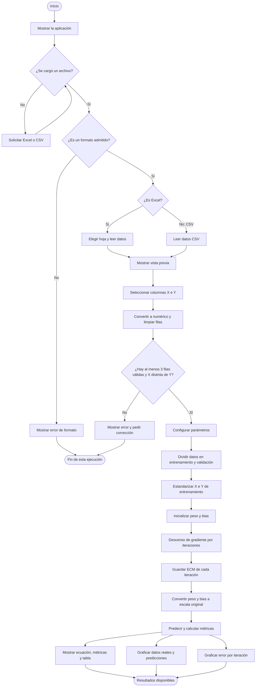

# Neurona artificial lineal para estimar Y desde X

Esta aplicación permite cargar un archivo de datos, seleccionar una variable de entrada **X** y una variable objetivo **Y**, y entrenar una neurona artificial lineal para aproximar la relación entre ambas.

El modelo que aprende tiene una sola entrada y una sola salida:

\[
\hat{Y} = wX + b
\]

Donde **w** es el peso de la neurona, **b** es el sesgo o bias y **Ŷ** es el valor que predice el modelo. La aplicación encuentra los valores de `w` y `b` reduciendo el error cuadrático medio mediante descenso de gradiente por lotes.

## Archivos

- `app.py`: contiene la interfaz de Streamlit y toda la lógica para cargar, preparar, separar, entrenar y evaluar los datos. No necesita importar un módulo local adicional.
- `requirements.txt`: lista las bibliotecas necesarias para ejecutar la aplicación.

## Datos de entrada

En la aplicación se puede cargar un archivo:

- Excel: `.xlsx` o `.xlsm`.
- CSV: `.csv`.

Los archivos deben tener encabezados y al menos dos columnas. Después de cargar el archivo, se selecciona una columna para **X** y otra distinta para **Y**. En un archivo Excel también se elige la hoja que se quiere analizar.

La app convierte las columnas elegidas a valores numéricos y descarta las filas donde X o Y estén vacías, no sean numéricas o contengan valores infinitos. Se requieren al menos tres filas numéricas válidas. La variable X debe variar en los datos usados para entrenar.

## Qué hace la aplicación

### 1. Carga e inspección

La app lee el archivo cargado, permite seleccionar la hoja cuando se trata de Excel y muestra una vista previa de las primeras filas. También informa cuántas filas y columnas se leyeron.

### 2. Selección y preparación de X e Y

El usuario elige las columnas que representan la entrada X y el resultado Y. La app conserva únicamente esas dos columnas, les asigna nombres internos y realiza la conversión a números. Las filas que no se puedan utilizar se eliminan y se informa cuántas quedaron disponibles.

### 3. Separación de los datos

Los datos válidos se mezclan con una semilla reproducible y se dividen en dos conjuntos:

- **Entrenamiento:** se utiliza para aprender los parámetros `w` y `b`.
- **Validación:** se reserva para evaluar predicciones sobre filas que no participaron en el ajuste.

La proporción de validación se puede cambiar desde la barra lateral. Por defecto, se reserva el 20 % de los datos.

### 4. Entrenamiento de la neurona

La app ajusta el modelo lineal `Ŷ = wX + b`. Para facilitar el cálculo, estandariza X e Y durante el entrenamiento. Esto ayuda a mantener estables las actualizaciones aunque las columnas tengan escalas diferentes. Al terminar, transforma los parámetros para mostrar el peso y el bias en las unidades originales de los datos.

En cada iteración se calcula el error entre las predicciones y los valores reales del conjunto de entrenamiento. El peso y el bias se actualizan en la dirección que reduce el error cuadrático medio (ECM). La cantidad de iteraciones y la tasa de aprendizaje se pueden modificar desde la barra lateral.

### 5. Resultados y visualizaciones

La aplicación presenta:

- **Peso (w)** y **bias (b)** aprendidos.
- La ecuación final del modelo, por ejemplo: `Ŷ = 1.8 · X + 32`.
- Una gráfica de los datos reales de entrenamiento y validación, junto con la recta de predicción de la neurona y las predicciones simuladas para cada conjunto.
- Una gráfica del ECM en función de las iteraciones del entrenamiento.
- Las métricas de entrenamiento y validación: **MAE** (error absoluto medio), **RMSE** (raíz del error cuadrático medio) y **R²** (coeficiente de determinación).
- Una tabla desplegable con los valores reales, las predicciones de la neurona, el conjunto asignado y el error por fila.

## Parámetros disponibles

En la barra lateral se pueden ajustar:

| Parámetro | Descripción | Valor inicial |
|---|---|---:|
| Datos para validación | Proporción reservada para evaluación | 20 % |
| Iteraciones de entrenamiento | Número de actualizaciones de los parámetros | 1000 |
| Tasa de aprendizaje | Tamaño de cada actualización de `w` y `b` | 0.05 |
| Semilla de la separación | Permite repetir la misma partición de filas | 42 |

## Pseudocódigo

```text
INICIO

  Mostrar título e instrucciones
  Solicitar archivo Excel o CSV

  SI no se cargó ningún archivo ENTONCES
    Mostrar mensaje para cargar datos
    DETENER ejecución hasta que se cargue un archivo
  FIN SI

  SI el archivo es Excel ENTONCES
    Leer nombres de hojas
    Solicitar al usuario que seleccione una hoja
    Leer la hoja seleccionada
  SINO SI el archivo es CSV ENTONCES
    Leer el archivo CSV
  SINO
    Mostrar error de formato
    DETENER
  FIN SI

  Mostrar dimensiones y vista previa del archivo
  Solicitar selección de una columna X y una columna Y

  Convertir X e Y a valores numéricos
  Eliminar filas vacías, no numéricas o infinitas

  SI hay menos de 3 filas válidas O X e Y son la misma columna ENTONCES
    Mostrar error
    DETENER
  FIN SI

  Leer proporción de validación, iteraciones, tasa de aprendizaje y semilla
  Mezclar índices de filas usando la semilla
  Separar índices en entrenamiento y validación

  Calcular media y desviación estándar de X e Y de entrenamiento
  Estandarizar X e Y de entrenamiento
  Inicializar peso y bias estandarizados en cero

  REPETIR para cada iteración:
    Calcular predicciones estandarizadas
    Calcular errores y gradientes del peso y del bias
    Actualizar peso y bias con la tasa de aprendizaje
    Calcular y guardar ECM en las unidades originales de Y
  FIN REPETIR

  Convertir peso y bias a las unidades originales
  Predecir Y para entrenamiento, validación y todas las filas
  Calcular MAE, RMSE y R² para entrenamiento y validación

  Mostrar peso, bias y ecuación aprendida
  Graficar datos reales, simulados y recta del modelo
  Graficar ECM por iteración
  Mostrar métricas y tabla de predicciones

FIN
```

## Diagrama de flujo general



## Ejecución local

Desde una terminal ubicada en la carpeta del proyecto:

```bash
python -m pip install -r requirements.txt
streamlit run app.py
```

Streamlit abrirá la aplicación en el navegador. Los datos se cargan desde la interfaz; no es necesario incluir el archivo Excel o CSV en el proyecto.

## Despliegue en Streamlit Community Cloud

1. Sube `app.py` y `requirements.txt` a la raíz de un repositorio de GitHub.
2. En Streamlit Community Cloud, crea una nueva aplicación y conecta ese repositorio.
3. Selecciona `app.py` como archivo principal.
4. Despliega la aplicación y carga el archivo de datos desde la interfaz.

## Alcance del modelo

Esta aplicación aprende una relación lineal entre una sola variable de entrada y una sola variable objetivo. El modelo puede no representar bien relaciones curvas, patrones con varias entradas o datos con estructuras temporales. Las métricas de validación ayudan a estimar el comportamiento con las filas reservadas, pero su resultado depende de la calidad y cantidad de datos cargados y de la partición seleccionada.
